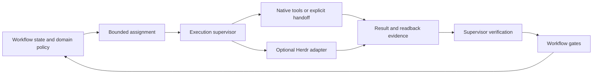

**CompleteTech LLC Skills** · [Start here](ONBOARDING.md) · [Agent instructions](SKILL.md) · [Skill library](references/skill-family.md) · [Contributing](CONTRIBUTING.md)

# Agentic Services Orchestrator Skill

<p align="center">
  <picture>
    <source media="(prefers-color-scheme: dark)" srcset="assets/logo-dark.png">
    
  </picture>
</p>

Coordinate workflow stages and approvals, supervise bounded assignments, and verify
results before advancing. CompleteTech services is the default domain; software
delivery and a non-software hiring example use the same core. Native agent tools,
explicit handoffs, and optional Herdr controls are separate runtime choices.

## Structure

Workflow state owns business status, artifact relationships, and approvals.
Execution state owns assignments, runtime ownership, progress, and completion
evidence. The local coordinator stores both in separate SQLite records with revision
checks. An agent's success report returns to the supervisor for verification, then
to workflow coordination for current gate validation.

[Architecture and boundaries](references/orchestration-architecture.md) explains
implemented behavior and limits. [Runtime adapters](references/runtime-adapters.md)
describes callback bindings and Herdr preparation. [Migration](references/migration.md)
preserves existing `project_state` and specialist entry points. The optional
[Herdr helper and references](adapters/herdr/README.md) are bundled here; a separate
repository is no longer required.



## Start

Python 3.12 is the CI baseline. Install dependencies before offline use:

```bash
python -m pip install -r requirements.txt
python scripts/validate_package.py
python examples/run_demo.py --out /tmp/orchestration-demo
```

On Windows choose a new writable private directory such as
`C:/Temp/orchestration-demo`, outside any enclosing Git checkout. The six-scenario
demo uses synthetic facts and simulated agent/remote receipts. It does not launch
client workflows, agents, merges, or deployments. Read [examples](examples/README.md)
for CLI receipt shapes and recovery commands.

## Components

| Path | Implemented responsibility |
|---|---|
| `SKILL.md` | Concise entry point and reference selection |
| `scripts/orchestration.py` | SQLite workflow/execution records, revisions, dispatch intent, result verification, gated transitions and recovery |
| `scripts/contracts.py` | JSON Schema validation and canonical digests |
| `scripts/runtime_adapters.py` | Native callbacks, explicit handoff, optional bundled Herdr preparation |
| `references/*-workflow.yaml` | Services, hiring and software domain policy |
| `references/assignment.schema.json`, `references/result.schema.json` | Machine-readable contracts |
| `adapters/herdr/` | Offline preparation helper, example, regressions and focused session/delivery/recovery references |
| `scripts/render_pdf.py` | Existing human-facing Markdown/PDF/optional PNG renderer |
| `scripts/skill_library.py` | Existing read-only catalog, install planning and sibling audit |

The services delivery specialist continues to own kickoff, evaluation, runbooks,
and closeout artifacts. The execution supervisor assigns and monitors agents.
See [specialist ownership](references/services-specialists.md).

## Files, network and approvals

Local validation, coordination, persistence, handoff preparation and PDF rendering
work offline after installation. Only explicitly selected, authorized runtime
bindings may access external agent tools, repositories or hosts. The package does
not install a scheduler or background service. Live observations, authority and
remote receipts must come from trusted operators/tools.

Keep selected state files and handoffs private and outside Git. JSON/YAML and SQLite
remain operational artifacts; branded PDFs are appropriate human-facing documents.
Generating a document or passing a test grants no business, publication, merge or
deployment authority. [Brand assets](BRAND_ASSETS.md) have separate rights from the
[MIT code license](LICENSE). Text-only registry bundles omit binary brand assets.

## Validation and packaging

```bash
python -m unittest discover -s tests -p 'test_*.py' -v
python scripts/validate_package.py
python scripts/validate_quality.py
```

See [Quality](QUALITY.md) and the [validation report](references/integration-validation.md)
for actual results, independent review and limitations. New checks cover scoped
authority, exact artifact revisions, independent review, uncertain effects,
duplicate/stale work, concurrent dispatch and interrupted-run recovery without
Herdr. The existing full-checkout package contract and sibling catalog remain.

Activation key: `agentic-services-orchestrator-skill`; version `1.1.0`.
Runtime: Python 3; dependencies are pinned in `requirements.txt`. Registry
publication is separate from local validation; see [ClawHub publishing](CLAW_HUB_PUBLISHING.md).
